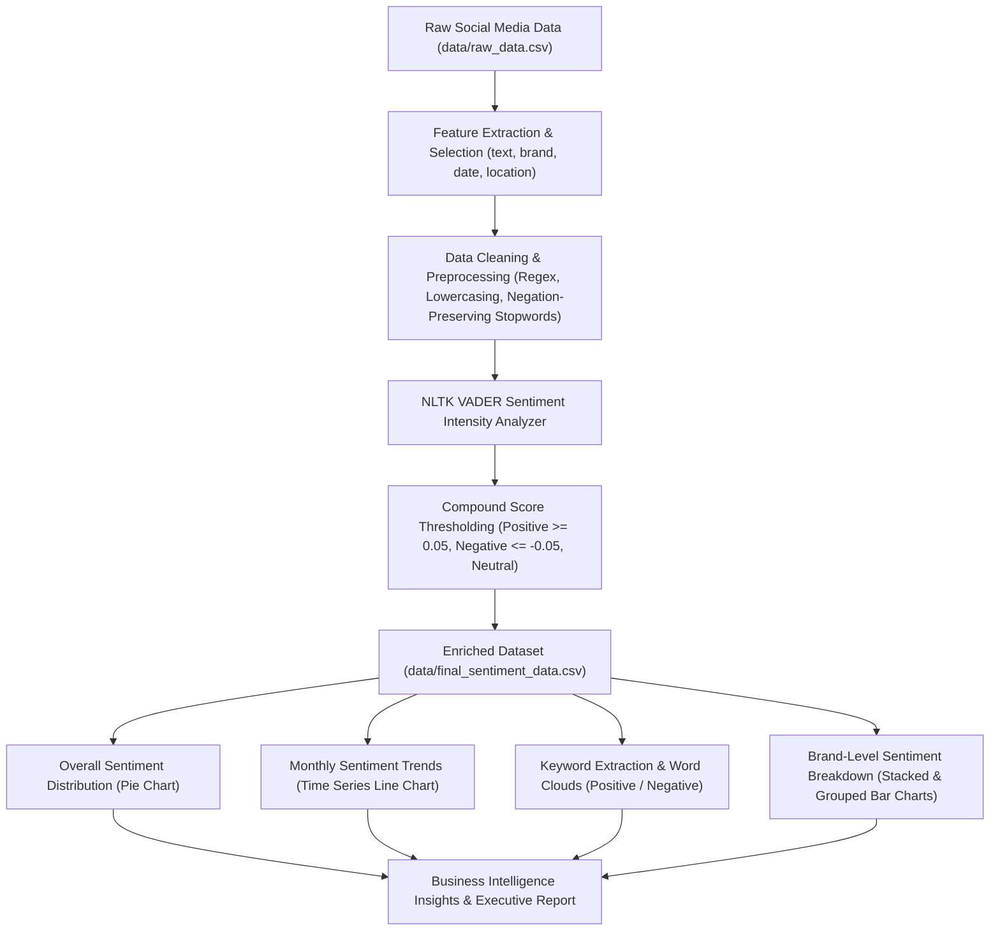
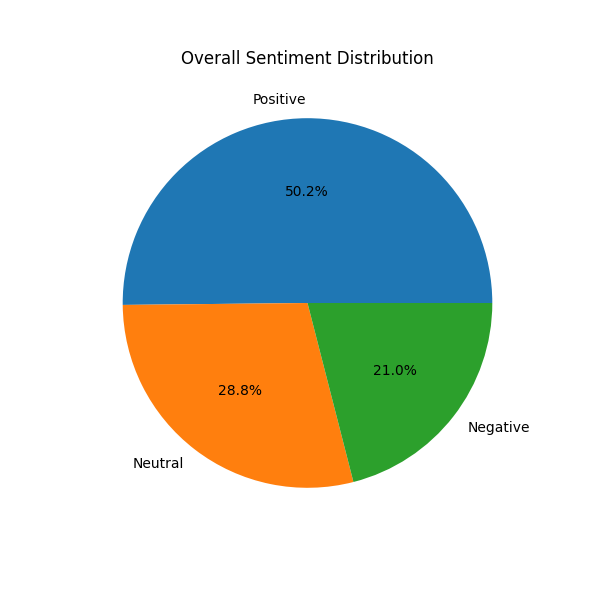
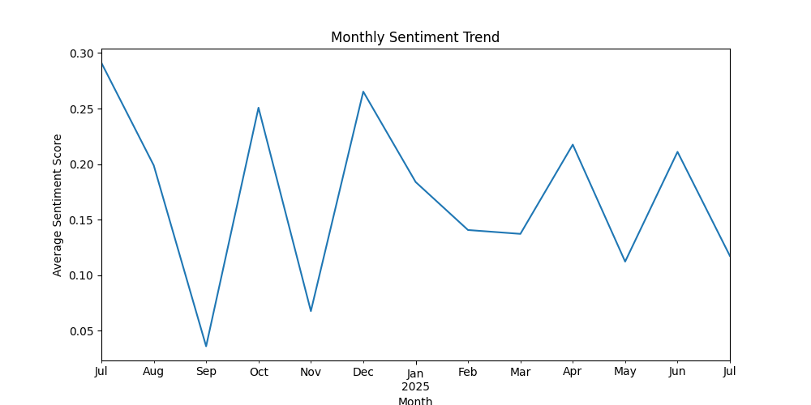
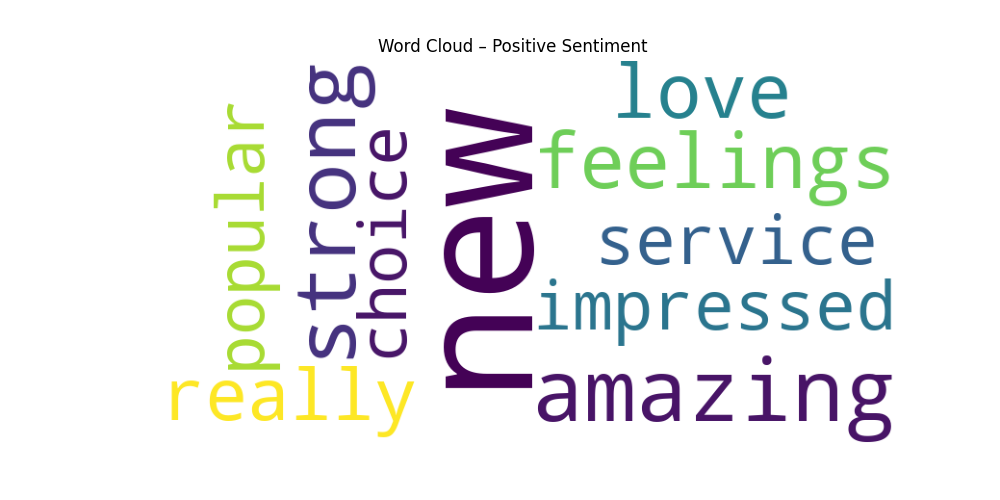
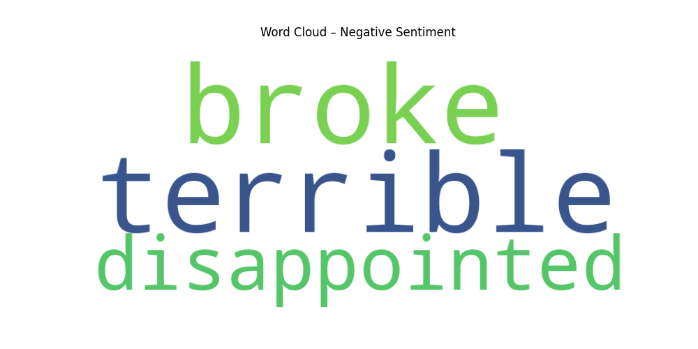
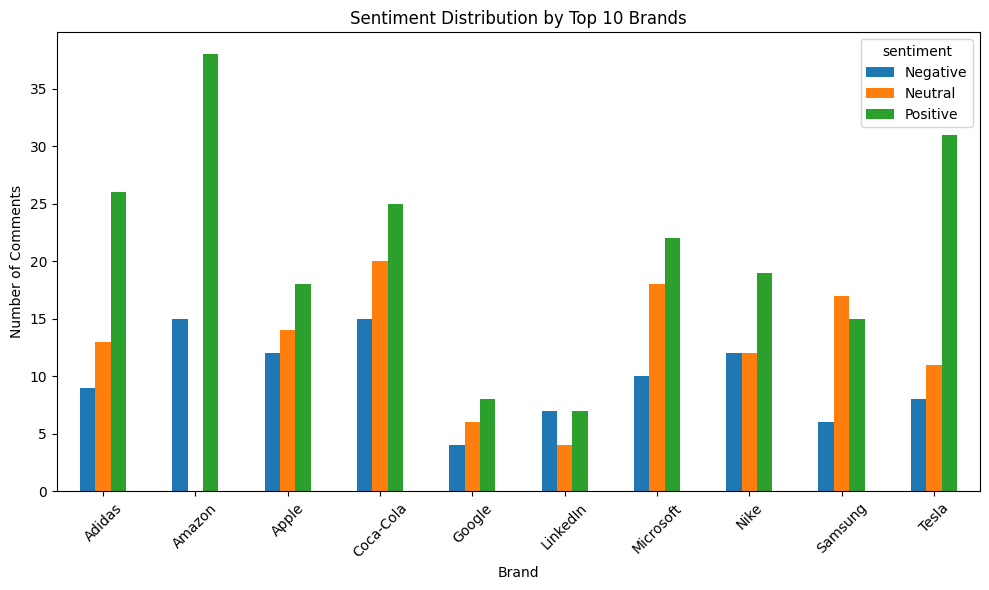
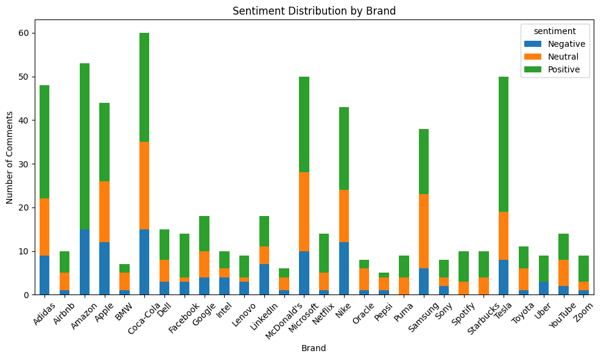

# 📊 Social Media Sentiment Analysis

[](https://www.python.org/)
[](https://www.nltk.org/)
[](https://pandas.pydata.org/)
[](LICENSE)

An end-to-end Natural Language Processing (NLP) and data analytics pipeline for monitoring and analyzing public sentiment across social media platforms. This project extracts, cleans, scores, and visualizes consumer sentiment towards various global brands using NLTK's VADER (Valence Aware Dictionary and sEntiment Reasoner), delivering actionable business intelligence and customer experience insights.

---

## 📌 Table of Contents

- [Overview & Objectives](#-overview--objectives)
- [Problem Statement](#-problem-statement)
- [Key Features](#-key-features)
- [Technologies & Libraries](#-technologies--libraries)
- [System Architecture & Workflow](#-system-architecture--workflow)
- [Project Directory Structure](#-project-directory-structure)
- [Dataset Details](#-dataset-details)
- [Installation & Setup](#-installation--setup)
- [How to Run](#-how-to-run)
- [Results & Visualizations](#-results--visualizations)
  - [Overall Sentiment Distribution](#1-overall-sentiment-distribution)
  - [Temporal Sentiment Trends](#2-temporal-sentiment-trends)
  - [Word Frequency & Word Clouds](#3-word-frequency--word-clouds)
  - [Brand-Level Sentiment Breakdown](#4-brand-level-sentiment-breakdown)
- [Business Insights & Recommendations](#-business-insights--recommendations)
- [Future Enhancements](#-future-enhancements)

---

## 📖 Overview & Objectives

In today's digital ecosystem, social media platforms serve as the primary arena where consumers voice feedback, praise product innovations, or express dissatisfaction. For enterprises, tracking and deciphering these voluminous, unstructured conversations is vital to brand health, proactive customer support, and strategic product development.

### Objectives:
- **Preprocess Unstructured Social Text:** Clean raw social media text data by stripping noise, URLs, and special characters while preserving critical negation words (`no`, `not`, `nor`, `never`).
- **Quantify Sentiment Polarity:** Utilize lexicon-based sentiment analysis (`NLTK VADER`) to compute normalized compound polarity scores between -1.0 and +1.0.
- **Categorize Sentiment:** Classify posts into three distinct categories: `Positive`, `Neutral`, and `Negative`.
- **Temporal & Cross-Brand Trend Analysis:** Trace sentiment fluctuations over time and evaluate consumer perception across different corporate brands.
- **Surface Key Discussion Drivers:** Isolate high-frequency terms in positive versus negative posts through customized stopword filtering and word cloud visualizations.

---

##  Problem Statement

Manual examination of social media comments is slow, unscalable, and susceptible to subjective bias. Unstructured social text often exhibits:
1. Significant noise (URLs, punctuation, formatting artifacts).
2. Subtle linguistic nuances such as negations (e.g., *"not bad"*, *"no issues"*) that standard stopword removal mistakenly strips.
3. Rapidly evolving trends requiring longitudinal monitoring to catch PR crises or product defects early.

This project delivers an automated, reproducible analytical workflow that ingests social text data, evaluates sentiment, and yields visual dashboards and reports for data-driven brand management.

---

##  Key Features

- **Robust Preprocessing Pipeline:**
  - Case folding (lowercasing).
  - URL and web artifact stripping via regular expressions.
  - Non-alphabetic character cleaning.
  - Custom stopword exclusion that preserves sentiment-critical negations (`no`, `not`, `nor`, `never`).
- **VADER Sentiment Scoring:**
  - Lexicon- and rule-based evaluation tuned specifically for social media microtext.
  - Threshold-based categorization:
    - **Positive:** $\text{compound score} \ge 0.05$
    - **Neutral:** $-0.05 < \text{compound score} < 0.05$
    - **Negative:** $\text{compound score} \le -0.05$
- **Longitudinal Trend Analysis:**
  - Monthly aggregation of sentiment scores to observe shifts in public satisfaction.
- **Lexical Frequency & Word Clouds:**
  - Identification of primary satisfaction drivers and complaint themes, excluding brand names and generic conversational stopwords.
- **Multi-Brand Comparative Analysis:**
  - Granular sentiment breakdown across individual brands and focused comparison of top 10 brands.

---

##  Technologies & Libraries

| Category | Tools / Libraries | Purpose |
| :--- | :--- | :--- |
| **Language** | Python 3.10+ | Core programming language |
| **Data Manipulation** | `pandas` | Tabular data manipulation, grouping, aggregations |
| **NLP & Sentiment Analysis** | `nltk` (VADER, stopwords) | Text normalization and lexicon-based polarity scoring |
| **Text Processing** | `re` (Regular Expressions) | Regex cleaning of URLs, punctuation, and whitespace |
| **Data Visualization** | `matplotlib` | Bar charts, line plots, pie charts |
| **Visual Analytics** | `wordcloud` | High-frequency term visualization |
| **Interactive Environment**| `Jupyter Notebook` / `IPython` | Prototyping, exploratory analysis, reproducible execution |

---

##  System Architecture & Workflow



---

##  Project Directory Structure

```plaintext
Social-Media-Sentiment-Analysis/
├── data/
│   ├── raw_data.csv                 # Original raw social media dataset (600 records, 25 attributes)
│   ├── basic_data.csv               # Extracted subset (text, brand, date, location)
│   ├── clean_data.csv               # Preprocessed text dataset
│   └── final_sentiment_data.csv     # Final dataset with sentiment scores and categories
├── jupyter_notebook/
│   └── sentiment_analysis.ipynb     # Comprehensive analysis and visualization notebook
├── visualization/
│   ├── sentiment_distribution.png   # Pie chart of overall sentiment breakdown
│   ├── sentiment_trend.png          # Monthly average sentiment trend line
│   ├── positive_wordcloud.png       # Word cloud of dominant positive terms
│   ├── negative_wordcloud.png       # Word cloud of dominant negative terms
│   ├── brand_sentiment_distribution.png     # Stacked bar chart for all brands
│   └── Topbrands_sentiment_distribution.png # Bar chart of top 10 brands
├── .gitignore                       # Git exclusion rules for clean version control
├── requirements.txt                 # Python package dependencies
└── README.md                        # Project documentation and summary
```

---

##  Dataset Details

The dataset comprises **600 social media interactions** spanning diverse consumer technology and lifestyle brands (e.g., Apple, Amazon, Microsoft, Nike, Tesla, Samsung, Adidas, Sony, Intel, Dell, BMW, Airbnb).

Key fields analyzed:
- `text`: Raw text comment/post from the user.
- `brand`: Associated brand identifier.
- `date`: Timestamp of the comment (standardized to `DD-MM-YYYY` / datetime).
- `location`: Geographic location of the user (e.g., USA, UK, Germany).
- `clean_text`: Normalized text output from the preprocessing pipeline.
- `sentiment_score`: Continuous VADER compound polarity metric $[-1.0, 1.0]$.
- `sentiment`: Discrete class label (`Positive`, `Neutral`, `Negative`).

---

##  Installation & Setup

### Prerequisites
- Python 3.10 or higher
- Git installed on your system

### 1. Clone the Repository
```bash
git clone https://github.com/ravanthika2006/Social-Media-Sentiment-Analysis.git
cd Social-Media-Sentiment-Analysis
```

### 2. Create and Activate a Virtual Environment
**On Windows:**
```bash
python -m venv venv
venv\Scripts\activate
```

**On macOS/Linux:**
```bash
python3 -m venv venv
source venv/bin/activate
```

### 3. Install Dependencies
```bash
pip install -r requirements.txt
```

### 4. Download Required NLTK Corpora
In your Python terminal or notebook:
```python
import nltk
nltk.download("stopwords")
nltk.download("vader_lexicon")
```

---

##  How to Run

Launch Jupyter Notebook or JupyterLab:

```bash
jupyter notebook
```

Navigate to `jupyter_notebook/sentiment_analysis.ipynb` and run all cells sequentially (`Cell > Run All`). The outputs will regenerate the processed CSVs in `data/` and all chart assets in `visualization/`.

---

##  Results & Visualizations

### 1. Overall Sentiment Distribution
Analysis across the 600 social media posts demonstrates a predominantly positive consumer sentiment:
- **Positive:** **50.2%** (301 posts)
- **Neutral:** **28.8%** (173 posts)
- **Negative:** **21.0%** (126 posts)

<p align="center">
  
</p>

---

### 2. Temporal Sentiment Trends
By aggregating the mean sentiment scores monthly, long-term trends and short-term volatility in customer satisfaction can be tracked:

<p align="center">
  
</p>

---

### 3. Word Frequency & Word Clouds
Custom domain stopword filtering was applied to strip brand names and generic conversational filler, revealing core emotional drivers:

| Sentiment | Top Frequent Terms | Underlying Driver / Concern |
| :--- | :--- | :--- |
| **Positive** | `new`, `amazing`, `strong`, `feelings`, `love`, `impressed`, `service`, `popular`, `choice` | Excitement over product launches, reliable service, and strong brand affinity |
| **Negative** | `terrible`, `broke`, `disappointed` | Hardware/product failure, reliability issues, unmet expectations |

#### Positive Sentiment Word Cloud
<p align="center">
  
</p>

#### Negative Sentiment Word Cloud
<p align="center">
  
</p>

---

### 4. Brand-Level Sentiment Breakdown
The comparative distribution provides clarity on which brands enjoy high positive loyalty versus those facing acute complaint spikes:

#### Sentiment Across Top 10 Brands
<p align="center">
  
</p>

#### Comprehensive Brand Sentiment Distribution
<p align="center">
  
</p>

---

##  Business Insights & Recommendations

1. **Leverage Launch Momentum:** Positive reception heavily centers around new releases (`new`, `amazing`, `impressed`). Brands should capitalize on launch windows to reinforce user engagement.
2. **Prioritize Product Reliability:** The prevailing negative terms (`broke`, `terrible`, `disappointed`) indicate that physical reliability failures are the root cause of negative social sentiment. Quality assurance and swift warranty/replacement handling should be top operational priorities.
3. **Continuous Social Listening:** Automated sentiment tracking provides early warning indicators before minor customer complaints escalate into widespread public relations challenges.

---

## 🔮 Future Enhancements

- [ ] **Transformer Models:** Fine-tune contextual deep learning architectures (e.g., `RoBERTa`, `BERTweet`) for domain-specific nuance and sarcasm detection.
- [ ] **Aspect-Based Sentiment Analysis (ABSA):** Automatically link sentiment directly to specific product dimensions (e.g., *battery life*, *pricing*, *customer support*).
- [ ] **Interactive Web Dashboard:** Build a live Streamlit or Dash web application for real-time social feed ingestion and dynamic KPI filtering.
- [ ] **Live API Streaming:** Connect to live social feeds (Twitter/X API, Reddit API) for automated continuous ingestion.

---

---

## 📄 License

This project is licensed under the MIT License - see the [LICENSE](LICENSE) file for details.
